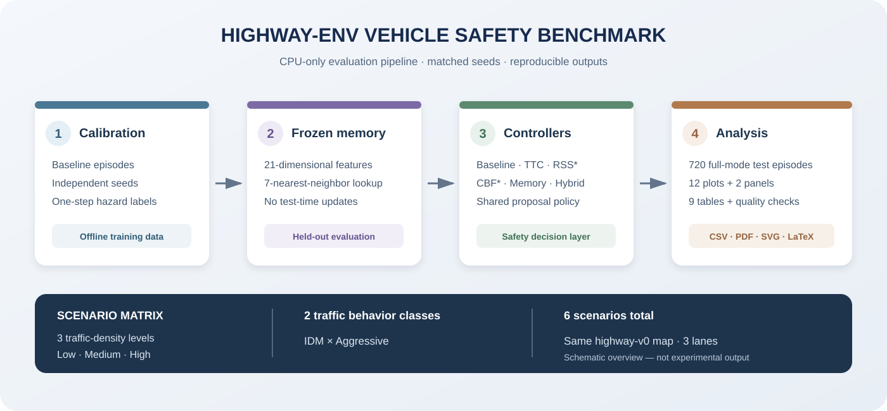
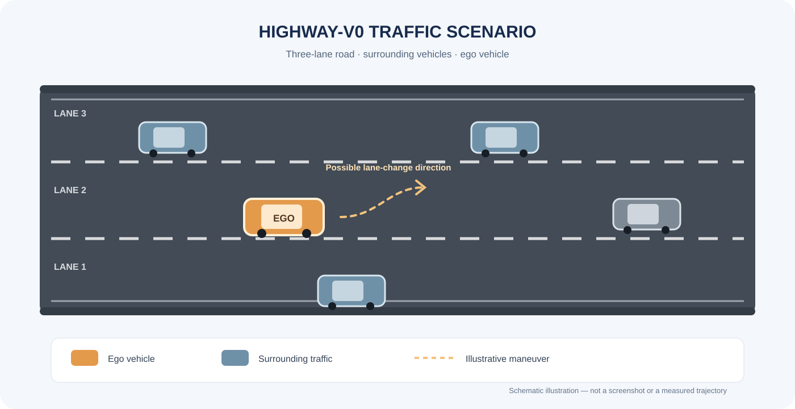

# 🛣️ Highway Controller Benchmark

**A reproducible, CPU-only benchmark of safety-oriented decision controllers for autonomous driving in [HighwayEnv](https://github.com/Farama-Foundation/HighwayEnv).**


---

## 🎯 Overview

This repository implements a controlled benchmark for comparing six lightweight, rule-based safety decision mechanisms in the `highway-v0` environment. The study focuses on the safety–mobility trade-off, intervention behavior, traffic-condition sensitivity, and per-decision CPU latency.

The benchmark does **not** train deep reinforcement-learning policies. All six methods use the same efficiency-oriented action-proposal policy. The five safety-augmented methods may replace an unsafe proposal with the conservative `SLOWER` fallback, while Baseline executes the proposal unchanged. The experiment therefore compares alternative safety layers around a common driving policy.

> **Hardware:** CPU only. No NVIDIA GPU, CUDA, or Google Colab is required.

## 🧭 Benchmark pipeline



The experiment first collects independent baseline calibration episodes, builds a frozen episodic memory, and then evaluates all controllers on held-out seeds. The analysis scripts export plots, tables, raw logs, and quality-control reports from the actual simulation outputs.

## 🚘 HighwayEnv scenario



The illustration above is schematic. During execution, the benchmark also saves real RGB frames rendered by HighwayEnv for the `high_idm` and `high_aggr` scenarios. They are written to:

```text
results/<mode>/figures/highway_env_high_idm.png
results/<mode>/figures/highway_env_high_aggr.png
```

## ✨ Main features

- 🧪 Six controllers evaluated with matched scenario/seed combinations.
- 🚦 Six traffic scenarios: three density levels and two traffic behavior classes.
- 🧠 Offline, frozen k-nearest-neighbor episodic memory.
- ⏱️ Per-decision CPU latency measurements (P50 and P95).
- 📉 Collision, near-miss-proxy, mobility, and intervention metrics.
- 🖼️ Real simulator screenshots saved during the experiment.
- 📊 Twelve individual plots, two composite panels, and nine tables.
- 📄 Tables exported as CSV, Markdown, and LaTeX.
- 🔎 Automated checks for missing data, duplicate episodes, seed leakage, scenario degeneracy, and incomplete paper assets.

## 🧩 Controllers

| Controller | Description |
|---|---|
| **Baseline** | Common efficiency-oriented proposal policy, without an additional safety shield. |
| **TTC** | Time-to-collision shield using front and rear closing-time checks, including lane-change checks. |
| **RSS*** | RSS-inspired longitudinal safe-gap rule with conservative merge-gap checks. It is not a complete RSS implementation. |
| **CBF*** | Discrete, one-step control-barrier-inspired heuristic. It is not a formally verified CBF and has no invariance proof. |
| **Memory** | Frozen episodic hazard memory using 21-dimensional features and weighted 7-nearest-neighbor retrieval. |
| **Hybrid** | TTC shield combined with episodic-memory hazard retrieval. |

All methods use the same proposed action and the same fallback mechanism. The asterisks in RSS* and CBF* are intentional: these are simplified benchmark heuristics, not certified implementations of the corresponding formal methods.

## 🚦 Scenario design

The benchmark uses one three-lane straight highway map with six predeclared traffic configurations.

| Scenario | Density level | Other-vehicle behavior | Configured vehicles | `vehicles_density` |
|---|---:|---|---:|---:|
| `low_idm` | Low | IDM | 16 | 0.65 |
| `mid_idm` | Medium | IDM | 25 | 1.25 |
| `high_idm` | High | IDM | 38 | 2.10 |
| `low_aggr` | Low | Aggressive | 16 | 0.65 |
| `mid_aggr` | Medium | Aggressive | 25 | 1.25 |
| `high_aggr` | High | Aggressive | 38 | 2.10 |

The simulation configuration uses three lanes, a 30-second episode duration, a 1 Hz policy frequency, and a 10 Hz simulation frequency. The IDM/aggressive distinction changes the behavior class of surrounding vehicles; it does not introduce a new road map.

## 🔬 Experimental protocol

Calibration and evaluation use separate seed ranges. Within each scenario, the same evaluation seeds are used across the six controllers to support matched comparisons. The trajectories may diverge after a controller intervenes.

| Run mode | Baseline calibration episodes per scenario | Evaluation episodes per scenario and controller | Total evaluation episodes |
|---|---:|---:|---:|
| Smoke | 1 | 1 | 36 |
| Pilot | 5 | 5 | 180 |
| Full | 8 | 20 | 720 |

The full preset therefore runs **720 evaluation episodes**, in addition to **48 baseline calibration episodes** (8 per scenario). The smoke and pilot presets are intended to verify the pipeline and inspect the experimental behavior before the full run.

### Metrics

- **Collision rate:** fraction of evaluation episodes ending in a collision.
- **Near-miss proxy exposure:** fraction of episode steps in which minimum TTC is below 2.5 s, minimum bumper gap is below 6 m, or a collision occurs.
- **Mobility:** mean ego speed, distance per simulated second, and cumulative reward.
- **Intervention behavior:** number and rate of proposed actions replaced by the fallback, including intervention attribution.
- **Decision latency:** P50 and P95 in milliseconds. Timing includes simulator-state extraction and controller decision logic; it excludes the environment step, rendering, file I/O, and memory training.

The near-miss indicators are operational proxies used by this benchmark. They should not be interpreted as a complete real-world risk or safety metric.

## 📦 Installation

### Requirements

- Windows 10/11
- Python 3.11 or 3.12 recommended
- CPU; no GPU required
- Internet connection for the initial Python package installation

The simulation engine is pinned to `highway-env==1.12.1`. The remaining dependencies are listed in [requirements.txt](requirements.txt).

### Option A — Recommended Windows scripts

Open PowerShell in the repository folder:

```powershell
git clone https://github.com/vitor-souza-ime/highway-controller-benchmark.git
cd highway-controller-benchmark
.\setup_windows.bat
```

The setup script creates a local `.venv`, installs the dependencies (including Jinja2 for LaTeX table export), and runs the unit tests. You do not need to activate the environment manually when using the provided `.bat` launchers.

### Option B — Global Python installation (without a virtual environment)

If you prefer to install the dependencies in your existing Python environment:

```powershell
py -3.11 -m pip install -r requirements.txt
$env:SDL_VIDEODRIVER = "dummy"
$env:PYGAME_HIDE_SUPPORT_PROMPT = "1"
py -3.11 -m unittest discover -s tests -v
```

When using this option, run the benchmark through `py -3.11 -m study.cli ...` rather than the supplied `.bat` launchers, because those launchers expect the local `.venv`.

## ▶️ Running the benchmark

Run the stages in order. Do not skip the smoke test or pilot review.

### 1. Smoke test

```powershell
.\run_smoke_windows.bat
```

Or, with a global Python installation:

```powershell
py -3.11 -m study.cli --mode smoke
```

Inspect `results/smoke/QUALITY_CHECK.txt`. A smoke run checks that the pipeline executes; it is not a substitute for the pilot.

### 2. Pilot

```powershell
.\run_pilot_windows.bat
```

Or:

```powershell
py -3.11 -m study.cli --mode pilot
```

Review the complete `results/pilot` directory and, especially, `QUALITY_CHECK.txt`. The pilot is also used to check whether the configured traffic levels produce distinguishable initial conditions and trajectories.

### 3. Full benchmark

Run the full experiment only after the pilot quality report returns **PASS**:

```powershell
.\run_full_windows.bat
```

Or:

```powershell
py -3.11 -m study.cli --mode full
```

The full-mode command enforces the pilot quality gate by default. A failed or review-status pilot should be investigated rather than bypassed.

### Useful maintenance commands

| Task | Windows launcher |
|---|---|
| Re-run unit tests | `verify_code_windows.bat` |
| Re-check pilot quality | `check_pilot_windows.bat` |
| Regenerate a report from existing CSV files | `regen_report_windows.bat` |
| Recover/regenerate the smoke report | `recover_smoke_windows.bat` |

For a direct Python installation, report regeneration can be performed with:

```powershell
py -3.11 -m study.cli --mode pilot --report-only
py -3.11 -m study.quality --out results/pilot
```

Replace `pilot` with `smoke` or `full` when appropriate.

## 📁 Generated files

Each run is written to `results/<mode>/`:

```text
results/
└── full/
    ├── episodes.csv
    ├── decisions.csv
    ├── calibration_transitions.csv
    ├── frozen_memory.npz
    ├── run_manifest.json
    ├── RESULTS_SUMMARY.txt
    ├── QUALITY_CHECK.txt
    ├── QUALITY_CHECK.json
    ├── report_manifest.json
    ├── paper_assets.tex
    ├── figures/
    │   ├── fig_01_collision_wilson.pdf / .png / .svg
    │   ├── fig_02_risk_exposure.pdf / .png / .svg
    │   ├── ...
    │   ├── fig_12_hybrid_attribution.pdf / .png / .svg
    │   ├── panel_A_safety.pdf / .png / .svg
    │   ├── panel_B_efficiency.pdf / .png / .svg
    │   ├── highway_env_high_idm.png
    │   └── highway_env_high_aggr.png
    └── tables/
        ├── table_01_protocol.csv / .md / .tex
        ├── ...
        └── table_09_ieee_pairwise_ci.csv / .md / .tex
```

The report generator creates:

**Figures**
1. Collision rate with Wilson 95% confidence intervals.
2. Near-miss proxy exposure.
3. Mean ego velocity.
4. CPU decision latency (P50 and P95).
5. Intervention rate.
6. Collision rate by traffic density.
7. Collision rate by surrounding-vehicle behavior.
8. Safety–mobility trade-off.
9. Empirical CDF of minimum TTC.
10. Scenario/controller collision heatmap.
11. Initial local-traffic distribution.
12. Hybrid intervention attribution.

**Tables**
1. Experimental protocol.
2. Overall controller metrics.
3. Results by scenario.
4. Paired collision-risk differences versus TTC.
5. Latency and intervention summary.
6. Intervention attribution.
7. Initial scenario conditions.
8. Compact IEEE summary.
9. Compact paired confidence intervals.

The generated `paper_assets.tex` is a figure-inclusion snippet, not a complete paper. All reported values are calculated from the run's CSV files; the report generator does not fabricate experimental results.

## 🛡️ Quality checks and interpretation

The quality checker verifies, among other things:

- required files and columns are present;
- each controller has the expected scenario/seed coverage;
- evaluation seeds do not overlap with calibration seeds;
- there are no duplicated episode or decision records;
- intervention attribution is consistent with proposed and executed actions;
- traffic-density settings are not empirically degenerate;
- rendered screenshots and the minimum number of plots/tables are valid.

A **PASS** means that the data and experiment structure passed the implemented integrity checks. It does **not** mean that a controller is superior, that a difference is statistically significant, or that the method is safe for deployment.

## ⚠️ Scope and limitations

The results must be interpreted within the following boundaries:

1. **Single map:** the benchmark uses the straight `highway-v0` topology. It does not evaluate intersections, ramps, or complex merging roads.
2. **Privileged state:** controllers read surrounding-vehicle information directly from the simulator's internal road state. This is not a perception pipeline and does not model noisy onboard sensors.
3. **Heuristic shields:** RSS* and CBF* are simplified surrogates. Neither provides a formal safety guarantee.
4. **Memory labels:** episodic memory is calibrated from one-step hazard labels observed after baseline actions. These labels are not counterfactual outcomes.
5. **Frozen evaluation:** memory is not updated during held-out evaluation episodes.
6. **Matched seeds:** methods start from matched seeds within each scenario, but their trajectories can diverge after different actions are executed.
7. **Latency scope:** reported decision latency excludes the simulation step, rendering, file operations, and memory training.
8. **Simulation evidence only:** empirical collision reductions in this environment do not establish real-world vehicle safety.

These limitations are part of the benchmark definition and should also be stated when using its results in a scientific paper.

## 🔗 Related software

- [HighwayEnv](https://github.com/Farama-Foundation/HighwayEnv) — highway driving simulator.
- [Gymnasium](https://gymnasium.farama.org/) — reinforcement-learning environment API.
- [NumPy](https://numpy.org/) and [Pandas](https://pandas.pydata.org/) — numerical processing and data analysis.
- [Matplotlib](https://matplotlib.org/) — plot generation.

## 📜 License

No `LICENSE` file is currently present in this repository. The reuse and redistribution terms should be specified by the repository owner before external redistribution.

---

<p align="center">
  <i>Highway Controller Benchmark · Reproducible CPU-only experiments for autonomous-driving research</i>
</p>
